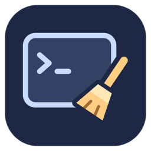
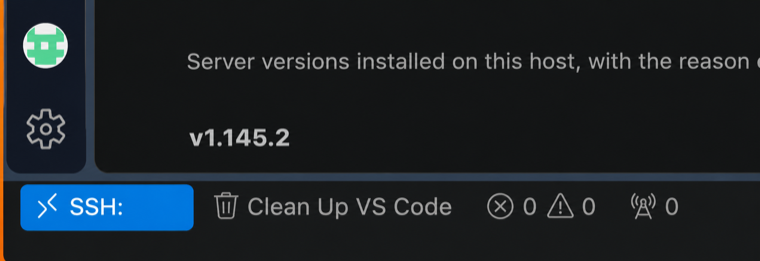

# Remote SSH Version Cleaner

Clean obsolete VS Code Stable server versions from Linux hosts connected through Remote SSH. Review exact paths and confirm removal using the **Clean Up VS Code** status-bar button.

## Where to find it

After installation, connect to a Linux host using **Remote SSH**. A **Clean Up VS Code** button appears in the bottom-left status bar. Click it to review old server versions before confirming removal.

The button text uses your theme’s warning color when a startup scan finds removable entries. Hover to see separate counts for server folders, launcher files, and legacy folders. It returns to the normal color when none are removable; a failed check is identified in the tooltip. Opening the view, refreshing, and completing cleanup update the result. Checks never delete anything automatically.

If the status bar is hidden, enable **View → Appearance → Status Bar**. The button appears only in Linux Remote SSH windows.

## Why I built this

My Linux servers kept running out of disk space, and old VS Code Remote server versions were part of the problem. I started cleaning them up by hand, then wrote a Bash script to automate it. This extension brings that workflow into VS Code: review what’s installed, see what can be removed, and confirm cleanup without opening a terminal.

## Install and use

1. Connect VS Code to a Linux host using Remote SSH.
2. Install **Remote SSH Version Cleaner** in that host’s Extensions section. Choose the Marketplace extension published by **amar-micro**. For a downloaded release, use **Extensions → … → Install from VSIX…** and select `amar-micro-remote-server-cleaner-0.5.6.vsix`. Reload if requested.
3. Click **Clean Up VS Code** in the bottom status bar.
4. Inspect the installed servers and protection reasons. The removal total breaks down server folders, launcher files, and legacy folders; then click **Review cleanup**.
5. Confirm the exact paths with **Delete obsolete entries**, or choose **Cancel**. After cleanup, the view shows removed paths and freshly scanned remaining installations.

The button appears after startup only in Linux Remote SSH windows. If hidden, enable **View → Appearance → Status Bar**. Install the extension on each host you want to clean. A local Mac or Windows installation alone does not clean remote servers.

No terminal commands or external runtimes are required for normal use. Cleanup operates only on the currently connected host and account; it does not enumerate SSH configurations or run automatically across hosts.

## Cleanup policy

Supports Linux Stable installations in `~/.vscode-server/cli/servers/Stable-<commit>`, associated `code-<commit>` files, and matching legacy `bin/<commit>` directories. Honors `VSCODE_AGENT_FOLDER` when set. Insiders and legacy-only layouts are not supported in this first version.

Keeps every commit of the highest numeric release and server folders referenced by running processes on this server owned by the current account. Running launchers and legacy server folders are protected independently; an old launcher does not protect its matching server folder. Validates installation names, product metadata, directory ancestors, and LRU schema. Malformed launcher names, launcher symlinks, and non-file launcher entries are marked REVIEW and preserved, as are legacy entries without a matching installed server. A regular `code-<40-character commit>` launcher is removable if it is neither for a newest installed server nor detected as running, including when its matching server is no longer installed. Extensions, settings, logs, and persistent data are outside the deletion scope.

Preview changes nothing. Apply requires confirmation, rescans the plan, and checks running commits again before each deletion. Existing `lru.json` gets a timestamped backup and atomic replacement retaining protected installed versions; an absent LRU stays absent. Removal is permanent; LRU backups do not restore deleted servers. If a later deletion fails, earlier deletions are not rolled back; refresh the cleanup view.

Process detection uses Linux `/proc`. If owned process command lines cannot be inspected, cleanup stops. This is best effort: another client can start a server between the final process check and deletion. Avoid connecting other VS Code clients to the same account while applying cleanup. There is no lock shared with VS Code's installer.

## Build from source

The runtime JavaScript needs no compilation or third-party dependencies. Use `npm run package` to create the Marketplace VSIX. Packaging requires Node.js and npm; the development checkout also uses Python 3 to export the release files before running the VS Code extension packaging tool. The resulting VSIX can be installed through VS Code’s Extensions panel.

## Support

Visit [Amar Micro Inc.](https://amar.com) and choose **Get in touch** to request support.

## License

MIT License. Copyright (c) 2026 Amar Micro Inc. See [LICENSE](LICENSE).
